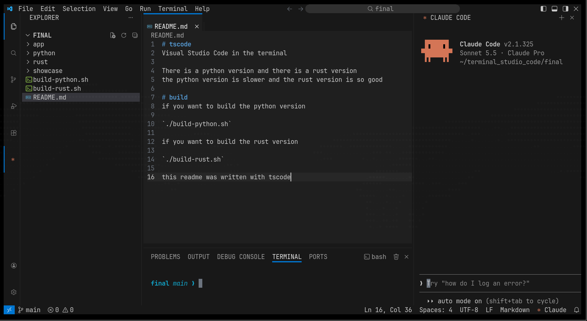

# tscode
Visual Studio Code in the terminal

There is a python version and there is a rust version
the python version is slower and the rust version is so good

# build
if you want to build the python version

`./build-python.sh`

if you want to build the rust version

`./build-rust.sh`

# launch

once built launch it with 

`tscode`

in the folder youre working on

# this readme was written with tscode btw

and some other info

it only works with linux atm

made with claude fable 5.2

made in omarchy linux

if you want it compatibile with windows or with mac tell claude to make it